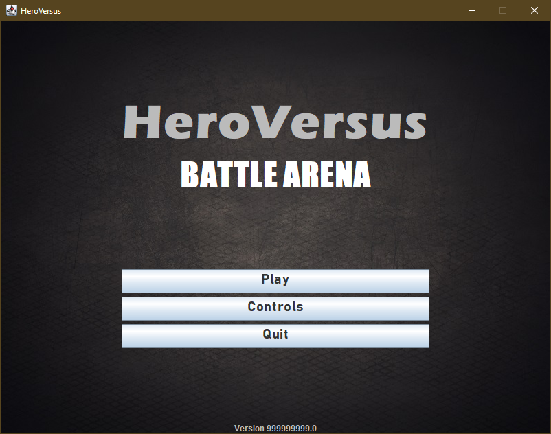
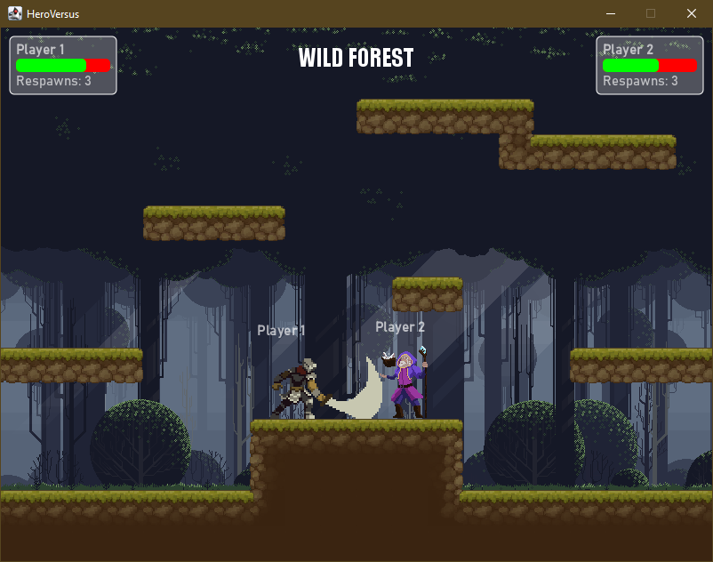
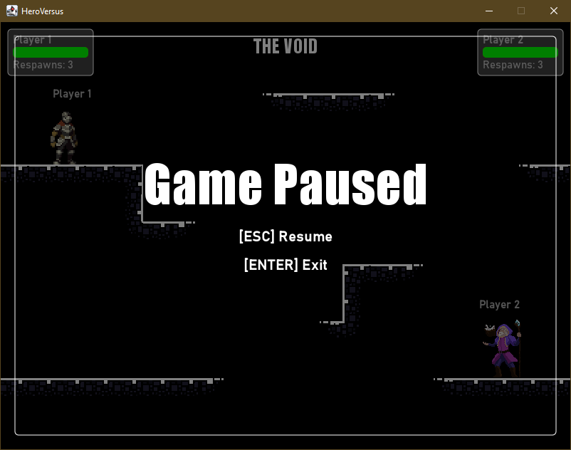
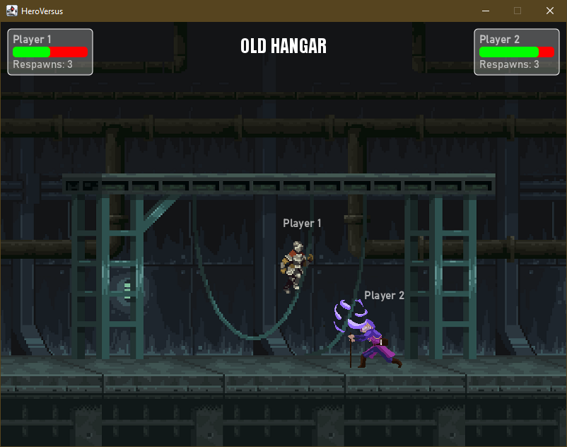

# HeroVersus: Battle Arena

A local two-player 2D fighting game, originally developed for the IN1007 Programming in Java module at City, University of London, in Spring 2023.

The project now uses Java 25, Gradle, and plain Swing menus.

The game pits two players against each other in a competitive fighting match set in unique arenas and environments. Each character boasts distinct abilities and moves, enhancing the strategic depth and replayability of the game.

## Features

- **Two-Player Gameplay**: Engage in intense two-player battles with a friend on the same keyboard.
- **Dynamic Arenas**: Each arena has unique elements and obstacles that can influence the outcome of the battle.
- **Customizable Characters**: Choose from a variety of characters, each with unique abilities and tactics.
- **Physics-Driven Interactions**: Utilize a modified version of the [JBox2D physics engine](https://github.com/jbox2d/jbox2d.git) for realistic movement and collision effects.

## Tech Stack


## Learning Outcomes

- **Object-Oriented Programming**: Applied advanced object-oriented concepts such as interfaces, abstract classes, and encapsulation to structure the game efficiently.
- **Java GUI Development**: Developed interactive menus and interfaces using Java's GUI toolkit.
- **Game Level Design**: Designed multiple game levels, each with its own set of challenges and characteristics.
- **Project Milestones**: Delivered the project in phases, adhering to deadlines and integrating feedback at each milestone.

## Gameplay Screenshots

### Title Screen



This screenshot shows the game's title screen, featuring a captivating background along with the main menu options: Play, Controls, and Quit. The design sets the mood for the adventures that await the player.

### Combat in Wild Forest Level



This image captures a moment of intense combat in the wild forest level. The player HUD is displayed at the top, showing the player IDs and their respective health bars, providing critical gameplay information during battles.

### Game Paused in Void Level



Here, the game is shown paused in the mysterious void level. The pause menu offers options to 'Exit to Main Menu' or 'Resume' the game, allowing players to take a break or strategically plan their next move.

### Combat in Hangar Level



Another example of combat, this time set in the hangar level, showcasing the uniqueness of this environment. The screenshot highlights the dynamic and interactive gameplay elements that differ with each level.

## Requirements

- JDK 25.
- The original course-provided `CityEngine.jar`.
- Optional: VS Code with the Extension Pack for Java.

Gradle is provided through the wrapper. MP3 dependencies are downloaded
automatically on the first build.

## Getting Started

Clone the repository:

```powershell
git clone https://github.com/mateuszs6/HeroVersusGame.git HeroVersus-Game cd HeroVersus-Game
```

Copy the original `CityEngine.jar` into the `lib` directory:

```text
lib/CityEngine.jar
```

The engine is not included in the repository. It already contains JBox2D; no separate JBox2D installation is needed.

Run the game from the project root:

```powershell
.\gradlew.bat run
```

In VS Code, open the project folder and allow the Java extensions to import
the Gradle project.

## Controls

| Action | Player 1 | Player 2 |
|---|---|---|
| Jump | W | Up arrow |
| Move left | A | Left arrow |
| Move right | D | Right arrow |
| Attack | R | Period (`.`) |

- **Esc:** pause or resume.
- **Enter:** return to the menu while paused or after a match.

Players currently use fixed characters: Knight and Wizard.

## Build

Compile and package the game:

```powershell
.\gradlew.bat clean build
```

Create a local installation containing the game and its dependencies:

```powershell
.\gradlew.bat installDist
```

Launch that installation:

```powershell
.\build\install\HeroVersusGame\bin\HeroVersusGame.bat
```

## Project layout

```text
src/main/java/               Game code and developer tools
src/main/resources/assets/   Runtime images, animations, and music
art/                        Source artwork and unused asset variants
lib/                        Local CityEngine library
docs/screenshots/           Gameplay screenshots
```

The game uses CityEngine's JBox2D-based physics, Swing for its interface,
and Java Sound with MP3SPI for music playback.